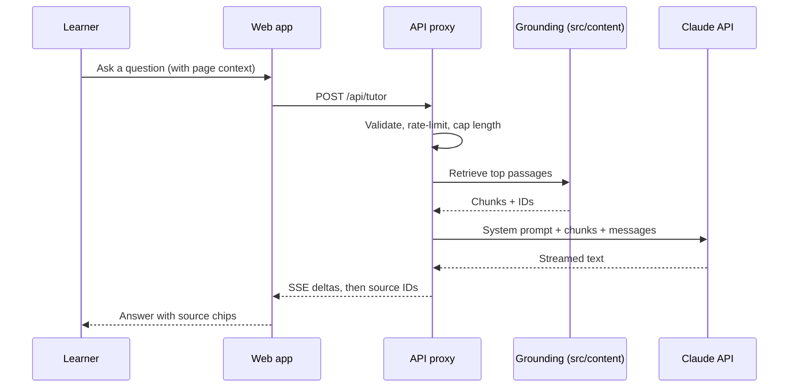
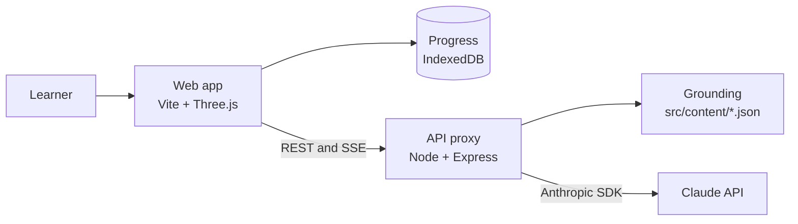

# 🧠 Inside the Brain

An interactive, AI-assisted neuroscience learning platform. Explore a 3D brain, trace how a thought forms across the cortex, and study with a tutor that answers from reviewed course content instead of guessing.

[](https://nodejs.org/)
[](https://threejs.org/)
[](https://vitejs.dev/)
[](#accessibility)
[](#license-and-credits)

**Project status:** v2.0 is in active development. v2 is a ground-up redesign of the original static site. Throughout this README, ✅ means shipped in v1 and 🆕 means new in v2 (in development). The [Roadmap](#roadmap) shows what is done. Exact dependency versions live in `package.json`, not in this file, so the README never goes stale.

<!-- Add a screenshot or short GIF here: docs/media/explorer.png -->

---

## Table of contents

- [Overview](#overview)
- [What's new in v2](#whats-new-in-v2)
- [Features](#features)
- [AI features in depth](#ai-features-in-depth)
- [Architecture](#architecture)
- [Project structure](#project-structure)
- [Quick start](#quick-start)
- [Configuration](#configuration)
- [API reference](#api-reference)
- [Content model](#content-model)
- [3D brain model](#3d-brain-model)
- [Design system](#design-system)
- [Accessibility](#accessibility)
- [Testing and quality](#testing-and-quality)
- [Deployment](#deployment)
- [Security and privacy](#security-and-privacy)
- [Migrating from v1](#migrating-from-v1)
- [Roadmap](#roadmap)
- [Contributing](#contributing)
- [Troubleshooting](#troubleshooting)
- [License and credits](#license-and-credits)

---

## Overview

Inside the Brain teaches how the brain works through three connected experiences:

| Experience | You learn | How |
|------------|-----------|-----|
| **Explore** | Where things are | A rotatable 3D brain with clickable regions |
| **Journey** | How a thought happens | A 7-stage teaching model, from sensation to action |
| **Library** | Why it works | Deep-dive topics on neurons, memory, emotion, and more |

Version 2 adds a **grounded AI layer** that ties them together: ask questions in context, describe a real moment and watch it traced through the brain, and practise with quizzes that schedule reviews for you.

**Who it's for:** high-school and undergraduate students, self-learners, and teachers who want a visual classroom resource.

### Design principles

- **Accurate first.** Every claim lives in reviewed JSON content with sources. The AI answers from that content and cites it.
- **Works without AI.** With no API key, the AI panels hide and everything else works.
- **Private by default.** No accounts, no analytics. Progress stays on the learner's device.
- **Accessible by design.** The 3D view always has a keyboard- and screen-reader-friendly equivalent.
- **Honest simplifications.** Teaching models (like the 7-stage pipeline) are labeled as models, not as how the brain literally works.

---

## What's new in v2

| Area | v1 | v2 |
|------|----|----|
| **Tooling** | Static HTML + `http-server` | Vite dev server, production builds, hot reload |
| **Content** | Hard-coded in HTML | Data-driven JSON in `src/content/`, validated by schema |
| **AI** | None | Grounded tutor, thought tracer, quiz generation |
| **Learning loop** | Read-only | Quizzes, spaced repetition, progress tracking, study export |
| **3D regions** | Bounding-box vertex coloring | Per-region meshes (atlas labeling as fallback), hover, isolate, explode |
| **Accessibility** | Not systematically tested | WCAG 2.2 AA target, keyboard navigation, reduced motion, colorblind-safe palette |
| **Typography** | Google Fonts CDN | Self-hosted variable fonts (faster, no third-party requests) |
| **Quality** | Manual | Unit, end-to-end, accessibility, and AI evaluation tests in CI |
| **Theme** | Dark only | Dark, light, and high-contrast |

---

## Features

### 3D Brain Explorer (`explore.html`)

| Capability | Status |
|------------|--------|
| Interactive Three.js model with orbit, zoom, auto-rotate | ✅ |
| Six color-coded regions with detail panels (description, functions, connections, facts) | ✅ |
| Click-to-select legend | ✅ |
| Hover tooltips and outline highlight | 🆕 |
| Isolate and explode views to inspect one region at a time | 🆕 |
| Opacity slider to see deeper structures | 🆕 |
| On-screen rotate and zoom buttons (no dragging required) | 🆕 |
| Keyboard navigation and a text-based region list (no mouse or WebGL required) | 🆕 |
| "Ask the tutor about this region" button | 🆕 |
| Colorblind-safe palette toggle | 🆕 |

### How Thoughts Form (`journey.html`)

A seven-stage teaching model:

| # | Stage | `stageId` |
|---|-------|-----------|
| 1 | Sensory input | `sensory` |
| 2 | Perception | `perception` |
| 3 | Attention | `attention` |
| 4 | Memory retrieval | `memory` |
| 5 | Emotional processing | `emotion` |
| 6 | Reasoning and decision | `reasoning` |
| 7 | Action | `action` |

> Real processing is massively parallel and recurrent. The stages are a way to organise ideas, and the page says so.

| Capability | Status |
|------------|--------|
| Stage-by-stage explanations with brain-region tags | ✅ |
| Auto-play with pause and resume | ✅ |
| Expandable deep dives | ✅ |
| Synced 3D view that highlights the active regions for each stage | 🆕 |
| Trace a Thought: AI maps your own scenario onto the stages | 🆕 |
| Shareable link to a traced result (stored in the URL fragment, never on a server) | 🆕 |

### Learning Library (`library.html`)

Six topics: Neural Communication, Sensory Perception, Memory and Learning, Emotions and Cognition, Reasoning and Behavior, Brain Network Cooperation.

| Capability | Status |
|------------|--------|
| Expandable deep-dive articles | ✅ |
| Searchable glossary with hover and focus definitions | 🆕 |
| Per-topic reading level (Curious / High school / Undergrad) | 🆕 |
| Cited sources on every article | 🆕 |
| "Quiz me on this topic" | 🆕 |
| Bookmarks and reading progress | 🆕 |

### Quiz and study tools (`quiz.html`) 🆕

- Multiple-choice quizzes per region, stage, or topic
- Reviewed question bank first, AI-generated questions to fill gaps (always labeled *AI-generated*)
- Spaced repetition with the SM-2 algorithm, so weak cards come back sooner
- Short AI explanations for wrong answers, grounded in the same sources
- Progress dashboard showing coverage by region and topic
- Export notes and flashcards as Markdown or JSON; import JSON to move progress between devices

---

## AI features in depth

Every AI feature is **grounded**: the server retrieves relevant passages from `src/content/`, gives them to the model, and instructs it to answer only from them and cite their IDs. If retrieval finds nothing relevant, the tutor says the question is outside the course content instead of improvising.



### 1. Ask the Brain (context-aware tutor)

A drawer available on every page.

- **Knows where you are.** Opening it from the Temporal Lobe panel sets the context chip: *Asking about: Temporal Lobe*.
- **Adjustable level:** Curious (age 12+), High school, Undergraduate, Pre-med.
- **Streaming answers** with source chips that open the underlying content card.
- **Follow-up actions:** *Explain differently*, *Give an analogy*, *Quiz me on this*.
- **Suggested questions** based on the current region, stage, or topic.

### 2. Trace a Thought

Describe a real moment and see it mapped onto the stages.

> *"I smelled fresh bread and suddenly remembered my grandmother's kitchen."*

The API returns structured JSON, validated against a schema. The Journey page animates the stages and the 3D view lights up the regions involved.

```json
{
  "stages": [
    {
      "stageId": "sensory",
      "regionIds": ["frontal", "temporal"],
      "structures": ["olfactory bulb", "piriform cortex"],
      "explanation": "...",
      "sourceIds": ["topic:sensory-perception"]
    },
    {
      "stageId": "memory",
      "regionIds": ["temporal"],
      "structures": ["hippocampus"],
      "explanation": "...",
      "sourceIds": ["topic:memory-learning"]
    },
    {
      "stageId": "emotion",
      "regionIds": ["temporal"],
      "structures": ["amygdala"],
      "explanation": "...",
      "sourceIds": ["topic:emotions-cognition"]
    }
  ],
  "caveats": ["Simplified model; real processing is parallel, not strictly sequential."]
}
```

**Schema rules**

- `stageId` must be one of the seven IDs above, and stages appear in pipeline order.
- `regionIds` must exist in `src/content/regions/`. Unknown IDs are rejected, so the 3D view never tries to highlight something that isn't there.
- `structures` names deeper structures as text until they get their own meshes ([v2.2](#roadmap)). For example, the hippocampus and amygdala sit in the medial temporal lobe, so they highlight `temporal` for now.

**Good answers handle nuance.** Smell is a classic example: olfactory signals reach the cortex without the thalamic relay that other senses use, and the olfactory pathway is closely connected to the amygdala and hippocampus, which helps explain why smells can trigger vivid memories.

### 3. Quiz generation

- The reviewed question bank (`src/content/questions/`) is served first.
- AI-generated questions are validated: exactly one correct option, an explanation, and `sourceIds` that exist. Invalid questions are discarded, not shown.
- Difficulty adapts to recent accuracy.
- Scheduling is deterministic (SM-2), so review timing never depends on the AI.

### Guardrails

| Risk | Mitigation |
|------|------------|
| Hallucinated facts | Retrieval grounding, mandatory source IDs, permission to say "I'm not sure", visible *AI-generated* label |
| Off-topic or medical questions | System prompt scopes the tutor to education; no diagnosis or treatment advice; points to a professional |
| Prompt injection | User text is treated as data. The tutor has no tools and no private data, so the worst case is an off-topic answer. Output is rendered as sanitized text, never raw HTML. |
| Key exposure | The API key lives only on the server; the browser never sees it |
| Abuse and cost | Per-IP rate limits, input and history caps, `max_tokens` caps, a cheaper model for structured tasks, streams aborted when the learner closes the drawer |
| Malformed output | Zod schema validation with one automatic retry, then a friendly error |

### Cost control

- Use a stronger model for open-ended tutoring and a faster, cheaper one for quizzes and tracing. Both are set by environment variable (see [Configuration](#configuration)).
- Cap conversation history (`MAX_TURNS`) so long chats don't grow the bill on every request.
- Consider [prompt caching](https://docs.claude.com/en/docs/build-with-claude/prompt-caching) for the long, unchanging part of the system prompt.
- Check the [Claude API docs](https://docs.claude.com/en/api/overview) for current model IDs and pricing.

---

## Architecture



**Why a server at all?** An API key must never ship to the browser. The small proxy holds the key, validates input, retrieves grounding passages, enforces rate limits, and streams the response back. Everything else is a static site.

### Tutor route

```javascript
// server/routes/tutor.js
import Anthropic from '@anthropic-ai/sdk';
import { tutorSchema } from '../lib/schemas.js';
import { retrieve }    from '../lib/grounding.js';
import { tutorSystemPrompt } from '../prompts/tutor.js';

const client = new Anthropic(); // reads ANTHROPIC_API_KEY from the environment

export async function tutor(req, res) {
  // Throws on invalid input; the error middleware turns it into a 400.
  // The schema caps message length, number of turns, and allowed roles.
  const { messages, context, level } = tutorSchema.parse(req.body);

  const chunks = retrieve(messages.at(-1).content, context, { k: 5 });

  res.set({
    'Content-Type':  'text/event-stream',
    'Cache-Control': 'no-cache',
    Connection:      'keep-alive',
  });
  res.flushHeaders();

  const send = (data) => res.write(`data: ${JSON.stringify(data)}\n\n`);

  const stream = client.messages.stream({
    model:      process.env.MODEL_TUTOR,
    max_tokens: Number(process.env.MAX_OUTPUT_TOKENS ?? 800),
    system:     tutorSystemPrompt({ level, chunks }),
    messages,
  });

  // Stop generating (and paying for) tokens if the learner closes the drawer.
  let clientGone = false;
  res.on('close', () => {
    if (!res.writableEnded) { clientGone = true; stream.abort(); }
  });

  stream.on('text', (delta) => send({ delta }));

  try {
    await stream.finalMessage();
    send({ done: true, sources: chunks.map((c) => c.id) });
  } catch (err) {
    if (!clientGone)
      send({ error: 'The tutor could not finish this answer.', code: 'UPSTREAM_ERROR' });
  } finally {
    res.end();
  }
}
```

### Grounding

Version 2.0 uses **keyword (BM25-style) retrieval** over content chunks. It is fast, free, deterministic, and good enough for a corpus this size. The current page context (region, stage, or topic) boosts matching chunks. Embedding-based retrieval is on the [roadmap](#roadmap).

---

## Project structure

```
inside-the-brain/
├── index.html                # Landing page
├── explore.html              # 3D brain explorer
├── journey.html              # How Thoughts Form (+ Trace a Thought)
├── library.html              # Learning library
├── quiz.html                 # Quizzes and study tools
├── public/
│   ├── models/brain.glb      # Compressed brain model (Draco or Meshopt)
│   ├── draco/                # Draco decoder files
│   └── images/
├── src/
│   ├── main.js
│   ├── components/           # nav, region-panel, tutor-drawer, quiz-card, stage-stepper
│   ├── three/                # scene, brain-model, region-picker, highlight
│   ├── ai/                   # client (SSE), context, prompt helpers
│   ├── learning/             # srs.js (SM-2), progress.js, export.js
│   ├── content/              # regions, stages, topics, glossary, questions (JSON)
│   │   └── schemas/          # JSON Schemas for every content type
│   ├── styles/               # tokens.css, base.css, components.css
│   └── utils/
├── server/
│   ├── index.js              # Express app
│   ├── routes/               # tutor.js, quiz.js, trace.js, health.js
│   ├── lib/                  # grounding.js, schemas.js, rateLimit.js
│   └── prompts/              # versioned system prompts
├── scripts/
│   └── validate-content.js   # schema + cross-reference checks for src/content
├── tests/
│   ├── unit/
│   ├── e2e/
│   └── evals/                # golden questions for AI grounding checks
├── .github/workflows/ci.yml
├── .env.example
├── Dockerfile
├── vite.config.js
└── package.json
```

---

## Quick start

### Prerequisites

- **Node.js 22 LTS** or newer and npm. Node 20 reached end of life in April 2026.
- A modern browser with **WebGL 2** (Chrome, Firefox, Edge, Safari)
- *(Optional)* An [Anthropic API key](https://console.anthropic.com/) to enable AI features

### Install and run

```bash
git clone <your-repo-url> inside-the-brain
cd inside-the-brain
npm install
cp .env.example .env          # add ANTHROPIC_API_KEY to enable AI features
npm run dev                    # web app on :5173, API on :8787
```

Open `http://localhost:5173`. Vite proxies `/api` to the API server, so there is nothing else to configure. This also removes the v1 need to run a separate static server just to load the 3D model.

**No API key?** Run `npm run dev:web`. The AI panels hide automatically and everything else works.

### Scripts

| Command | What it does |
|---------|-------------|
| `npm run dev` | Web app and API together with hot reload |
| `npm run dev:web` | Frontend only (AI panels hide automatically) |
| `npm run dev:api` | API server only |
| `npm run build` | Production build into `dist/` |
| `npm run preview` | Serve the production build locally |
| `npm test` | Unit tests (Vitest) |
| `npm run test:e2e` | End-to-end and accessibility tests (Playwright) |
| `npm run eval:ai` | Run golden questions against the live API and check citations (uses your key) |
| `npm run lint` | ESLint and Prettier checks |
| `npm run content:validate` | Validate all JSON content against its schema |

---

## Configuration

Copy `.env.example` to `.env`.

| Variable | Default | Description |
|----------|---------|-------------|
| `ANTHROPIC_API_KEY` | *none* | Enables AI features. Server only. Never prefix with `VITE_`. |
| `MODEL_TUTOR` | `claude-sonnet-5-5` | Model for open-ended tutoring |
| `MODEL_FAST` | `claude-haiku-5-5` | Model for quizzes and thought tracing |
| `PORT` | `8787` | API server port |
| `ALLOWED_ORIGIN` | `http://localhost:5173` | CORS allow-list (comma-separated for several origins) |
| `TRUST_PROXY` | `false` | Set to `1` behind a reverse proxy or load balancer so rate limits see the real client IP |
| `RATE_LIMIT_PER_MIN` | `20` | Requests per IP per minute on AI routes |
| `MAX_INPUT_CHARS` | `1000` | Maximum length of one learner message |
| `MAX_TURNS` | `12` | Maximum messages of history sent to the model |
| `MAX_OUTPUT_TOKENS` | `800` | Upper bound on tutor answer length |
| `VITE_AI_ENABLED` | `true` | Set `false` to hide all AI UI at build time |

---

## API reference

**Base path:** `/api`. All bodies are JSON and validated with Zod.

**Error format:** `{ "error": "Human-readable message", "code": "MACHINE_CODE" }`

| Code | HTTP | Meaning |
|------|------|---------|
| `INVALID_INPUT` | 400 | Body failed validation (too long, unknown ID, wrong shape) |
| `RATE_LIMITED` | 429 | Too many requests; check the `Retry-After` header |
| `AI_DISABLED` | 503 | No API key configured |
| `UPSTREAM_ERROR` | 502 | The model request failed or returned invalid output twice |

### `POST /api/tutor`

Streams a grounded answer as Server-Sent Events.

```json
{
  "messages": [{ "role": "user", "content": "Why does the hippocampus matter for memory?" }],
  "context": { "page": "explore", "regionId": "temporal" },
  "level": "highschool"
}
```

**Events:** `{ "delta": "text" }` repeated, then `{ "done": true, "sources": ["region:temporal", "topic:memory-learning"] }`. On failure mid-stream: `{ "error": "...", "code": "UPSTREAM_ERROR" }`.

`level` is one of `curious`, `highschool`, `undergrad`, `premed`.

### `POST /api/trace`

```json
{
  "scenario": "I smelled fresh bread and remembered my grandmother's kitchen."
}
```

Returns the structured stage mapping shown in [Trace a Thought](#2-trace-a-thought).

### `POST /api/quiz`

```json
{
  "scope": { "type": "region", "id": "frontal" },
  "count": 5,
  "difficulty": "medium"
}
```

Returns:

```json
{
  "questions": [
    {
      "id": "q:frontal:012",
      "prompt": "...",
      "options": ["...", "...", "...", "..."],
      "correctIndex": 2,
      "explanation": "...",
      "sourceIds": ["region:frontal"],
      "origin": "bank"
    }
  ]
}
```

`origin` is `bank` (reviewed) or `ai` (generated and validated).

### `GET /api/health`

Returns `{ "ok": true, "ai": true | false }` so the UI knows whether to show AI features.

---

## Content model

Content is data, not markup. One edit to a JSON file updates the page, the AI's knowledge, and the quizzes.

```json
{
  "id": "temporal",
  "name": "Temporal Lobe",
  "color": "#4CAF50",
  "summary": "Short, plain-language description.",
  "functions": ["Auditory processing", "Language comprehension", "Memory formation"],
  "structures": ["Hippocampus", "Amygdala", "Primary auditory cortex"],
  "connections": [
    { "to": "frontal", "via": "Uncinate fasciculus", "note": "Links memory with decision-making." }
  ],
  "facts": [{ "text": "A memorable, verifiable fact.", "sourceIndex": 0 }],
  "sources": [
    { "title": "Principles of Neural Science", "authors": "Kandel et al.", "edition": "6th", "year": 2021 }
  ],
  "lastReviewed": "2026-10-25",
  "reviewedBy": "github-handle"
}
```

`npm run content:validate` fails the build if a record:

- is missing a required field,
- has a broken cross-reference (for example, a connection to a region that doesn't exist),
- has a fact that doesn't point to a source, or
- has no source at all.

### Content accuracy checklist

- Every statistic has a source and a date.
- Ranges are stated as ranges. For example, ~86 billion neurons is a widely cited estimate; synapse counts are commonly given from roughly 100 trillion upward; the fastest axonal conduction is about 120 m/s (approximately 268 mph), which is a maximum for large myelinated fibers, not a universal signal speed.
- Simplifications are labeled as simplifications.
- Avoid popular myths (the "10% of the brain" myth, strict left-brain/right-brain personalities, learning styles). If a topic mentions one, it explains why it's a myth.

---

## 3D brain model

The model is based on **Frank Johansson's anatomical brain reference**, delivered as a compressed GLB. See [License and credits](#license-and-credits) for attribution requirements.

### Regions and palette

| Region | `id` | Default | Colorblind-safe (Okabe-Ito) |
|--------|------|---------|-----------------------------|
| Frontal lobe | `frontal` | `#4A90D9` | `#0072B2` |
| Parietal lobe | `parietal` | `#F5D63D` | `#F0E442` |
| Temporal lobe | `temporal` | `#4CAF50` | `#009E73` |
| Occipital lobe | `occipital` | `#E53935` | `#D55E00` |
| Cerebellum | `cerebellum` | `#AB47BC` | `#CC79A7` |
| Brainstem | `brainstem` | `#FF9800` | `#E69F00` |

The default palette pairs red and green, which many learners can't tell apart, so the **Okabe-Ito toggle matters**. Color is never the only cue: every region also has a text label, a legend entry, and an outline on hover and focus.

### Region identification

| Method | Notes |
|--------|-------|
| **Per-region meshes** (recommended) | Split the model by region in Blender so each lobe is its own named mesh (`frontal`, `parietal`, ...). Enables raycast picking, isolate, and explode views, and removes guesswork. |
| **Atlas-based labeling** | Label vertices from an established parcellation such as Desikan-Killiany. More accurate than geometry heuristics. |
| **Bounding-box heuristic** (v1 `getLobeFromPoint`) | Kept only as a last-resort fallback. Lobe boundaries follow sulci, not boxes, so expect misclassified vertices near borders. |

### Performance targets

- Model under 3 MB (Draco or Meshopt geometry; KTX2 textures if any)
- Lazy-load the model when the Explorer opens, with a loading state and a text-list fallback
- Render on demand: pause the loop when the tab is hidden, nothing is moving, or the user prefers reduced motion
- Cap device pixel ratio at 2 on high-density screens

---

## Design system

The plum-and-gold identity is kept and formalized as design tokens in `src/styles/tokens.css`.

```css
:root {
  --bg:        #0F0B14;
  --surface:   #181220;
  --plum-500:  #7B3FA0;   /* decorative fills only */
  --plum-300:  #B58AD6;   /* text-safe accent, about 7:1 on --bg */
  --gold-300:  #D4C5A0;
  --text:      #EDE7F3;
  --radius:    14px;
}
```

> **Contrast note.** `#7B3FA0` on `#0F0B14` is about 2.8:1. That fails WCAG AA for normal text (4.5:1), large text (3:1), and meaningful UI components such as borders and icons (3:1), so use it for **purely decorative fills only**. Use `--plum-300` for links, labels, focus rings, and any text.

| Token group | Notes |
|-------------|-------|
| Typography | Fraunces (headings) and Inter (body), self-hosted via Fontsource |
| Scale | Fluid type with `clamp()`; 4 px spacing grid |
| Themes | Dark (default), light, high-contrast; respects `prefers-color-scheme` and `prefers-contrast` |
| Motion | Glows, float, and shimmer are disabled under `prefers-reduced-motion` |
| Components | Nav, cards, region panel, stage stepper, tutor drawer, quiz card, toast |

---

## Accessibility

**Target:** WCAG 2.2 AA.

### Keyboard and pointer

- Full keyboard operation, including the 3D view: `Tab` to the region list, `Enter` to select, arrow keys to rotate the focused canvas, `+`/`-` to zoom, `Esc` to deselect
- On-screen rotate and zoom buttons, so dragging is never required (WCAG 2.5.7)
- Interactive targets at least 24 x 24 CSS px (WCAG 2.5.8)
- Visible focus that is never hidden behind the tutor drawer or sticky nav (WCAG 2.4.11)
- A skip-to-content link

### Screen readers

- A text alternative to the canvas: a structured list of regions with the same information as the 3D panels
- Region selection is announced (*"Temporal lobe selected"*)
- Streaming AI answers are announced once complete, not word by word

### Motion and vision

- Auto-rotate and Journey auto-play can be paused at any time (WCAG 2.2.2), and are off under reduced motion
- Colorblind-safe palette and a high-contrast theme
- Text resizes to 200% without loss of content

**Testing:** automated axe-core checks in the end-to-end suite, plus a manual pass with a screen reader (NVDA or VoiceOver) and keyboard only before each release. Automated tools catch only part of the problems.

---

## Testing and quality

| Layer | Tool | Covers |
|-------|------|--------|
| Unit | Vitest | SM-2 scheduling, retrieval ranking, schema validation, content links |
| End-to-end | Playwright | Navigation, region selection, quiz flow, tutor drawer (API mocked) |
| Accessibility | axe-core via Playwright | Every page in each theme |
| AI evaluation | `npm run eval:ai` | Golden questions: answer cites valid sources, stays in scope, declines medical advice, trace output passes schema |
| Performance | Lighthouse CI | Budgets below |
| Content | `content:validate` | Schemas, cross-references, required sources |

**Targets:** Lighthouse Performance >= 90, Accessibility >= 95, LCP < 2.5 s on a mid-range laptop.

CI (`.github/workflows/ci.yml`) runs lint, unit tests, content validation, build, and end-to-end tests on every pull request. AI evaluations call the real API, so they run on a schedule or manually rather than on every PR.

Prompt changes are versioned in `server/prompts/` and must pass `eval:ai` before merging.

---

## Deployment

### Option A: static site plus serverless functions

Deploy `dist/` to Netlify, Vercel, or Cloudflare Pages and run the `server/` routes as functions. Add `ANTHROPIC_API_KEY` as a secret in the host's dashboard.

**Things to check on serverless hosts:**

- **Streaming:** confirm your host supports streamed (SSE) responses and that function timeouts are long enough for a full answer.
- **Rate limiting:** in-memory counters don't work across many function instances. Use the host's rate limiting or a shared store (for example Redis or a KV service).
- **Redirects:** add redirect rules for the old v1 URLs (see [Migrating from v1](#migrating-from-v1)).

### Option B: single container

```bash
docker build -t inside-the-brain .
docker run -p 8787:8787 --env-file .env inside-the-brain
```

The container serves the built frontend and the API from one process. Behind a reverse proxy, set `TRUST_PROXY=1`.

### Before going live

- [ ] `ALLOWED_ORIGIN` set to your production domain
- [ ] `TRUST_PROXY` set correctly for your hosting setup
- [ ] Rate limits, input caps, and `MAX_TURNS` reviewed
- [ ] A monthly spend limit set on your Anthropic account
- [ ] `npm run eval:ai` passing against the production models
- [ ] Privacy notice reviewed for your audience (see below)
- [ ] Model license and attribution verified (see [Credits](#license-and-credits))

---

## Security and privacy

- **No accounts, no tracking.** Progress lives in the browser's IndexedDB. Export and import are available as JSON.
- **Secrets stay server-side.** Only `VITE_`-prefixed variables reach the client, and none of them are secret.
- **Learner messages** are sent to the Claude API to generate answers. The tutor drawer tells learners not to enter personal or health information. The server does not log message content by default.
- **Shared trace links** keep the scenario in the URL fragment (`#...`), which browsers don't send to the server. Anyone with the link can read it, and the UI says so before sharing.
- **Younger learners.** The audience includes under-18s (the Curious level starts at 12+). Before deploying to schools or minors, review [Anthropic's usage policies](https://www.anthropic.com/legal/aup) and the data-protection rules that apply to you (for example COPPA in the US or GDPR in the EU), and consider running with `VITE_AI_ENABLED=false` until that review is done.
- **Output safety:** AI text is rendered through a sanitizer; HTML is never injected raw.
- **Dependencies:** `npm audit` and Dependabot run in CI.
- **Reporting a vulnerability:** please open a private security advisory on the repository rather than a public issue.

---

## Migrating from v1

| v1 file | v2 location | Notes |
|---------|-------------|-------|
| `brain.html` | `index.html` | Add a redirect rule |
| `explore.html` | `explore.html` | Same URL |
| `thoughts.html` | `journey.html` | Add a redirect rule |
| `departments.html` | `library.html` | Add a redirect rule |
| `css/shared.css` | `src/styles/` | Split into tokens, base, components |
| Inline page content | `src/content/*.json` | Extract once, then edit data only |
| `brain_c.glb` | `public/models/brain.glb` | Re-export as per-region meshes when ready |
| `npx http-server ...` | `npm run dev` | No separate server needed |

Redirects depend on your host: a `_redirects` file on Netlify or Cloudflare Pages, `vercel.json` on Vercel, or Express routes in the container build.

---

## Roadmap

### v2.0 — Foundation

- [ ] Vite migration and shared layout
- [ ] Content extracted to validated JSON
- [ ] Reviewed question bank (at least 10 questions per region and topic)
- [ ] Ask the Brain tutor (grounded, streaming)
- [ ] Trace a Thought with synced 3D highlights
- [ ] Quizzes with spaced repetition
- [ ] Accessibility pass (keyboard, reduced motion, colorblind palette, manual screen-reader test)
- [ ] AI evaluation suite in place

### v2.1 — Reach

- [ ] Offline support (PWA; AI features need a connection)
- [ ] Read-aloud for articles and tutor answers
- [ ] Internationalization (content and UI strings)
- [ ] Embedding-based retrieval

### v2.2 — Depth

- [ ] Deep structures as individual meshes: hippocampus, amygdala, thalamus, basal ganglia, olfactory bulb
- [ ] Cross-section slicing
- [ ] Guided tours (for example, "What happens when you read this sentence?")

### v3 — Classroom

- [ ] Teacher mode with shareable class links and assignments
- [ ] Printable worksheets generated from content
- [ ] Anonymous, opt-in aggregate analytics for teachers

---

## Contributing

Contributions are welcome, especially content review from neuroscience educators.

1. Fork and create a branch: `feat/...`, `fix/...`, or `content/...`
2. Use [Conventional Commits](https://www.conventionalcommits.org/) (`feat: add isolate view`)
3. Run `npm run lint && npm test && npm run content:validate`
4. Open a pull request with a screenshot or short recording for UI changes

**Content pull requests** must cite a source for every new claim, update `lastReviewed` and `reviewedBy`, and pass `content:validate`.

**Prompt pull requests** must bump the prompt version in `server/prompts/` and include `eval:ai` results.

Good first issues are labeled `good first issue`. Please follow the code of conduct in `CODE_OF_CONDUCT.md`.

---

## Troubleshooting

| Symptom | Likely cause and fix |
|---------|---------------------|
| 3D model doesn't load | Don't open HTML files with `file://`. Use `npm run dev`; browsers block module and model loading without HTTP. |
| Blank canvas, no error | WebGL is disabled or unsupported. Use the text region list, or enable hardware acceleration in browser settings. |
| Draco decode error | Confirm `public/draco/` exists and the loader's decoder path is `/draco/`. |
| `npm install` fails or engines warning | Check `node -v`; Node 22 LTS or newer is required. |
| AI drawer says "unavailable" | `ANTHROPIC_API_KEY` missing, or `/api/health` returns `ai: false`. Check `.env` and restart the API. |
| Answer stops halfway | `MAX_OUTPUT_TOKENS` is too low, or your host's function timeout cut the stream. |
| 429 Too Many Requests | Rate limit reached. Wait for `Retry-After`, or raise `RATE_LIMIT_PER_MIN`. |
| Everyone gets rate-limited at once in production | The server sees the proxy's IP, not the learner's. Set `TRUST_PROXY=1`. |
| CORS error in production | Set `ALLOWED_ORIGIN` to your site's exact origin (scheme, host, and port). |
| Trace highlights nothing | The model returned region IDs that don't exist; check server logs for schema rejections. |
| Tutor answers feel generic | Check that the *Asking about* chip is set and that content for that region exists and passes validation. |

---

## License and credits

Inside the Brain is an educational resource. See `LICENSE` for the code license. Content in `src/content/` may carry a separate license; see `CONTENT_LICENSE` if present.

- **3D brain model:** Frank Johansson's anatomical brain reference. Confirm the model's license terms and keep the required attribution in the app footer.
- **3D rendering:** [Three.js](https://threejs.org/) by mrdoob and contributors
- **AI features:** [Claude API](https://docs.claude.com/en/api/overview) by Anthropic
- **Colorblind palette:** Okabe and Ito, *Color Universal Design*
- **Fonts:** Fraunces and Inter (SIL Open Font License), self-hosted via Fontsource
- **Scientific content:** based on established neuroscience literature; sources are listed per record in `src/content/`

> **Disclaimer.** This project is for education only. It is not medical advice and must not be used for diagnosis or treatment decisions. Consult a qualified professional for health concerns.
