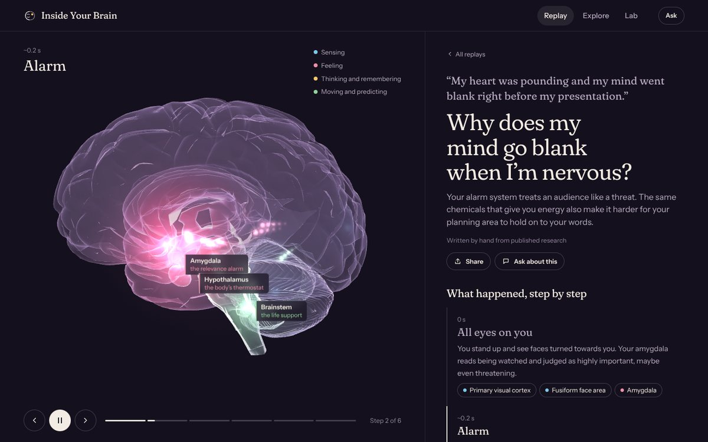
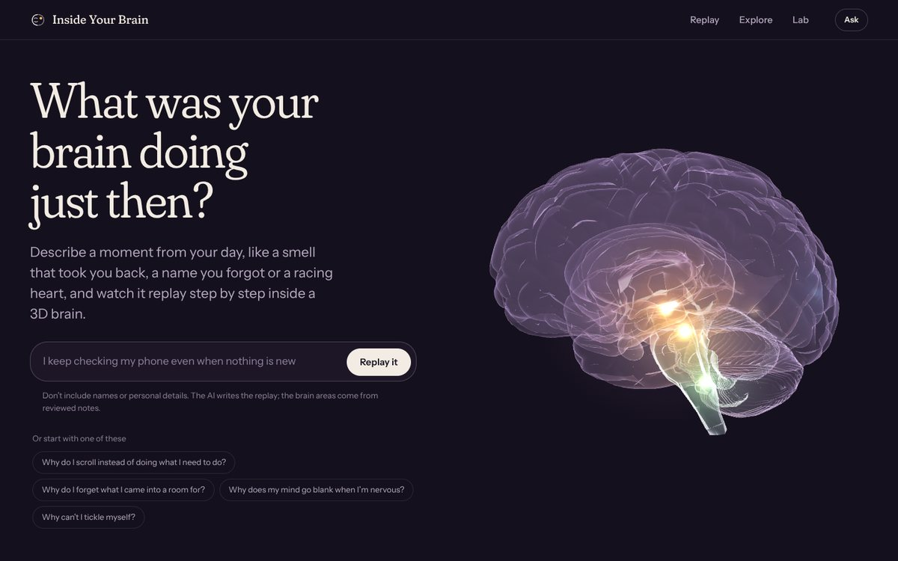
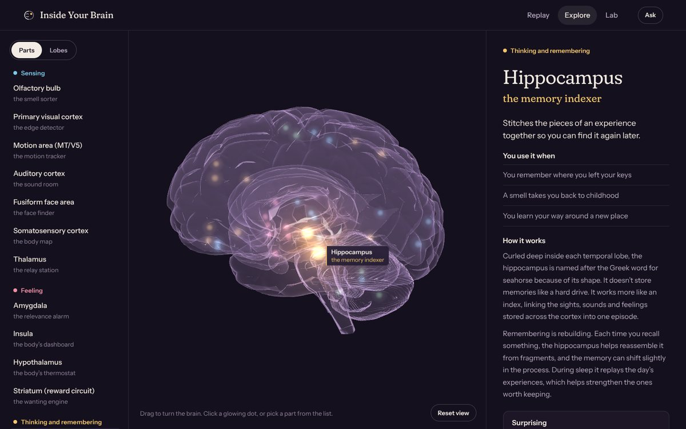
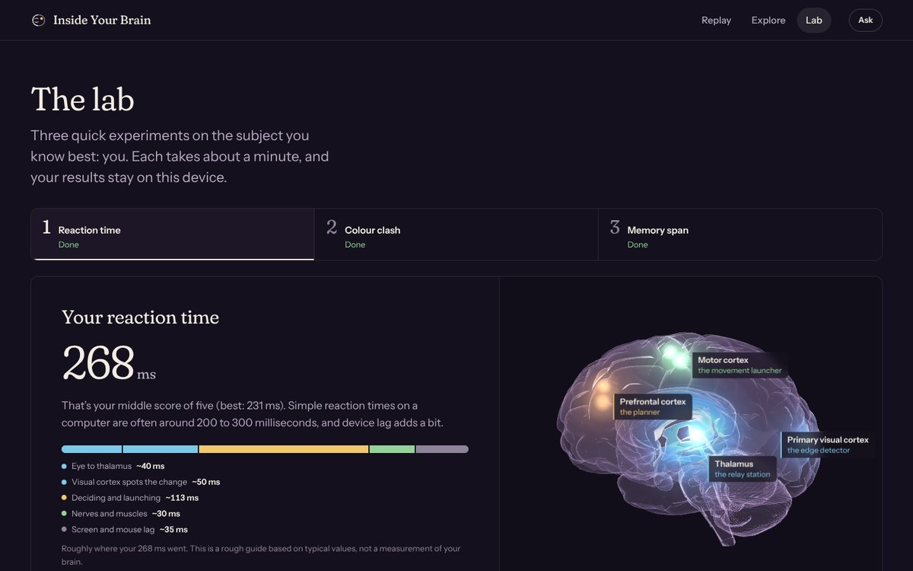
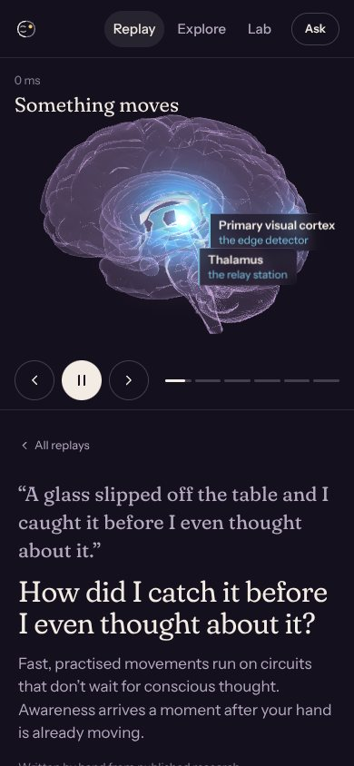

# Inside Your Brain

**Describe a moment from your day and watch it replay, step by step, inside a 3D brain.**

Inside Your Brain is for people who have never cared about psychology. It doesn't start with anatomy. It starts with something that happened to you, like a smell that took you back, a name you forgot or a racing heart before a talk. Then it shows what your brain did, in order, in plain language.



| | |
|---|---|
|  |  |
|  |  |

---

## Contents

1. [What it does](#what-it-does)
2. [What changed from v2](#what-changed-from-v2)
3. [How the AI is used](#how-the-ai-is-used)
4. [Quick start](#quick-start)
5. [Configuration](#configuration)
6. [Project structure](#project-structure)
7. [The 3D brain](#the-3d-brain)
8. [Content and accuracy](#content-and-accuracy)
9. [API](#api)
10. [Design](#design)
11. [Accessibility](#accessibility)
12. [Testing](#testing)
13. [Deployment](#deployment)
14. [Privacy and safety](#privacy-and-safety)
15. [Roadmap](#roadmap)
16. [Credits](#credits)

---

## What it does

| Page | What you do | What you get |
|---|---|---|
| **Replay** (the core) | Type a moment, or pick an everyday mystery | A 4–6 step replay on a glass brain: which areas lit up, roughly when, which chemicals were involved, **why it felt that way**, things to try, and the fine print |
| **Explore** | Spin the brain, click a glowing dot | 21 brain areas, each explained by *what you use it for* (“You use it when…”) rather than by Latin names |
| **Lab** | Three one-minute experiments | Your reaction time, your Stroop “colour clash” cost and your memory span, with your own numbers explained through the brain |
| **Ask** (on every page) | Ask a question in your own words | A short answer grounded in the app’s reviewed notes. It knows what you’re looking at, and you can follow up with *Simpler*, *Give me an analogy*, *Go deeper* or *What can I do with this?* |

**It works without an API key.** Eight hand-written replays, the explorer and the lab need no AI. With a key, people can replay *their own* moments and use Ask.

### The eight hand-written replays

- Why can a smell bring back a memory so fast?
- Why do I scroll instead of doing what I need to do?
- Why do I forget what I came into a room for?
- Why does my mind go blank when I’m nervous?
- Why do songs get stuck in my head?
- How did I catch it before I even thought about it?
- Why can I recognise a face but blank on the name?
- Why can’t I tickle myself?

Each one lists its published sources.

---

## What changed from v2

| | v2 | v3 |
|---|---|---|
| **Starting point** | Anatomy first (lobes, fasciculi) | Your own moment first, anatomy second |
| **Home page** | Illustrated portrait | Live 3D brain with background activity, and a box to type a moment |
| **AI** | Endpoints returned “coming in v2.0” | Working replay generator (structured JSON) and a streaming, grounded Ask guide |
| **3D brain** | Opaque, coloured by bounding boxes (most of the temporal lobe came out frontal) | See-through “glass” brain, 21 glowing structures including deep ones (hippocampus, amygdala, thalamus, reward circuit), signals that travel between them, and a lobe view based on real landmarks |
| **Thought journey** | Fixed 7-stage list, not connected to the brain | Any moment becomes a replay that drives the brain in sync |
| **Quiz** | Multiple-choice quiz with spaced repetition | Removed. Replaced by the Lab: experiments *on you*, not questions *about* the brain |
| **Library** | Separate textbook-style page | Folded into the explorer and replays |
| **Look** | Emoji icons, template copy | No emoji, self-hosted Fraunces and Instrument Sans, colour used only to mean something |
| **Draco decoder and fonts** | Loaded from Google’s servers | Served locally |

Old URLs (`journey.html`, `library.html`, `quiz.html`, `thoughts.html`, `departments.html`, `brain.html`) redirect to the new pages when you run the production server.

---

## How the AI is used

The AI isn't a chatbot bolted on the side. It does two specific jobs, and each one is checked.

### 1. Replay generator (`POST /api/replay`)

The person’s moment goes to the model with:

- the catalogue of the **21 brain areas** the app can show, with their reviewed one-line descriptions,
- the list of **10 chemicals** it may mention,
- one hand-written replay as a style reference,
- rules: second person, plain language, honest timings, no diagnosis, no invented studies or statistics, no popular myths.

The response must match a **JSON schema** sent through [structured outputs](https://docs.claude.com/en/docs/build-with-claude/structured-outputs). Brain areas and chemicals are `enum`s, so the model physically can’t light up an area the 3D brain doesn’t have. The server then validates the result again with Zod, trims anything too long, drops duplicate or unknown IDs, and retries once if fewer than three usable steps remain. While the model writes, the server streams progress (“step 3 drafted”) so the wait feels shorter.

Every response also carries a `safety` field:

| `safety` | When | What the person sees |
|---|---|---|
| `ok` | A real moment, however small or silly | The replay |
| `support` | Mentions of self-harm, suicide, abuse or danger | A short, caring message, emergency guidance and a link to [findahelpline.com](https://findahelpline.com). No replay. |
| `off_topic` | “Write my essay”, code, random text | A friendly nudge with an example moment to try |

If someone types a moment that exactly matches a hand-written replay, the server returns the reviewed version for free.

### 2. Ask guide (`POST /api/ask`)

A streaming answer, grounded in the app’s notes:

1. The server collects the notes for what you’re looking at (the selected brain area, the replay’s areas, or your Lab numbers) plus the top keyword matches for your question (BM25-style retrieval).
2. The model answers from those notes and says when something is uncertain or debated.
3. The UI shows **which notes it used** as chips you can click to open them in the explorer.

Follow-up buttons change the answer style rather than just the wording: simpler, an analogy (and where it breaks down), one level deeper, or practical takeaways.

### Guardrails

| Risk | What the app does |
|---|---|
| Made-up anatomy | Brain areas and chemicals are schema `enum`s, validated again on the server |
| Made-up facts | Grounded on reviewed notes, told not to invent studies or numbers, shows sources, labels everything *AI-generated* |
| Medical misuse | Educational scope only: no diagnosis, labels or medication advice. Health symptoms always come with “see a doctor”. |
| Someone in crisis | The `support` path replaces the replay with care and resources |
| Prompt injection | The moment is wrapped as data, and the prompt says to ignore instructions inside it. The model has no tools and no private data. Output is rendered as text, never HTML. |
| Shared links | Shared AI replays travel in the URL `#fragment` (never sent to the server). They're treated as untrusted input on open: only known brain areas are kept, and everything is rendered as text. |
| Cost and abuse | Per-IP rate limit, input and history caps, `max_tokens` caps, prompt caching on the long replay prompt, a cheaper model for Ask, and generation stops when the visitor leaves |
| Key exposure | The key lives only on the server. Only `VITE_`-prefixed variables reach the browser, and none are secret. |

---

## Quick start

**You need:** Node.js 22 or newer.

```bash
npm install
cp .env.example .env     # optional: add ANTHROPIC_API_KEY for AI replays and Ask
npm run dev              # site on http://localhost:5173, API on :8787
```

**No key yet?** Set `MOCK_AI=true` in `.env` to try the whole flow with canned answers (demo mode). It picks the closest hand-written replay for anything you type.

| Command | What it does |
|---|---|
| `npm run dev` | Site and API together, with hot reload |
| `npm run dev:web` | Site only (AI features hide themselves) |
| `npm run dev:api` | API only |
| `npm run build` | Production build into `dist/` |
| `npm start` | Serve `dist/` and the API from one process (port 8787) |
| `npm run preview` | Build, then start |
| `npm test` | Server unit tests (Node’s built-in test runner) |
| `npm run content:validate` | Check every replay only uses brain areas and chemicals that exist |

---

## Configuration

All settings live in `.env` (see `.env.example`).

| Variable | Default | Purpose |
|---|---|---|
| `ANTHROPIC_API_KEY` | none | Turns on AI replays and Ask. **Server only.** |
| `MODEL_REPLAY` | `claude-sonnet-5-5` | Writes replays. Must support structured outputs. |
| `MODEL_ASK` | `claude-haiku-5-5` | Answers questions |
| `MOCK_AI` | `false` | Demo mode: canned answers, no API calls |
| `PORT` | `8787` | Server port |
| `ALLOWED_ORIGIN` | empty | Only needed if the site and API are on different domains |
| `TRUST_PROXY` | `false` | Set to `1` behind a proxy so rate limits see real IPs |
| `RATE_LIMIT_PER_MIN` | `20` | AI requests per IP per minute |
| `MAX_INPUT_CHARS` | `600` | Longest moment or question |
| `MAX_TURNS` | `12` | Conversation history sent to the model |
| `MAX_OUTPUT_TOKENS` | `700` | Longest Ask answer |
| `VITE_AI_ENABLED` | `true` | Set `false` at build time to hide all AI UI |

Check the [Claude API docs](https://docs.claude.com/en/api/overview) for current model names and pricing.

---

## Project structure

```
inside-your-brain/
├── index.html  replay.html  explore.html  lab.html
├── public/
│   ├── models/brain.glb          # Draco-compressed brain mesh
│   ├── draco/                    # Draco decoder, served locally
│   └── favicon.svg
├── src/
│   ├── brain/
│   │   ├── brain-view.js         # The 3D glass brain (shader, glows, signals, labels, camera)
│   │   └── anatomy.js            # Structure positions, lobe map, colour groups
│   ├── content/
│   │   ├── structures.json       # 21 brain areas: plain-language notes and sources
│   │   ├── chemicals.json        # 10 neurochemicals in one sentence each
│   │   ├── replays/*.json        # 8 hand-written replays (generated from scripts/replays-source.py)
│   │   └── replays.js
│   ├── pages/                    # home.js, replay.js, explore.js, lab.js
│   ├── ui/                       # shell, Ask drawer, API client, share links, DOM helpers
│   └── styles/                   # tokens, base, components, pages
├── server/
│   ├── index.js                  # Express: API, static site, old-URL redirects
│   ├── routes/replay.js  ask.js
│   ├── lib/                      # content loader, JSON schema + validator, retrieval, HTTP helpers
│   └── prompts/index.js          # Versioned system prompts
├── scripts/
│   ├── validate-content.js
│   └── replays-source.py         # Easier place to write long replay text
├── tests/server.test.js
├── docs/screens/                 # Screenshots used in this README
├── Dockerfile
└── .env.example
```

---

## The 3D brain

The model is a single mesh, so regions are added in code rather than baked into the file.

- **Glass shader.** A custom `ShaderMaterial` draws the brain as a translucent shell with a soft rim (back faces first, then front faces). Activity is a set of glowing hotspots passed to the shader as uniforms, so glows spread smoothly over the surface instead of filling hard-edged regions.
- **21 structures** sit at hand-calibrated positions inside the model (`src/content/structures.json`, `pos: [distance from midline, height, front–back]`). Deep structures glow through the shell. Paired structures appear in both hemispheres. Broca’s and Wernicke’s areas are left-side only.
- **Signals.** When a replay moves to the next step, small pulses travel along curved paths from the previous step’s areas to the new ones.
- **Camera.** It turns to face whichever areas are active. Lateral areas are shown from their own side, and deep or midline ones from an oblique angle.
- **Lobe view.** In the explorer, each vertex is assigned a lobe using sloped boundaries that follow the main landmarks (lateral fissure, central sulcus, parieto-occipital line). It’s still a teaching approximation, and the page says so.
- **Labels.** HTML labels follow each active structure on screen, with its name and nickname.
- **Performance.** Rendering pauses when the brain is off screen or the tab is hidden. The pixel ratio is capped. three.js gets its own cached chunk.
- **Reduced motion.** No auto-rotate, no travelling signals, no auto-play. Steps change only when you press Next.

The +x side of the model is the subject’s **left** hemisphere. This comes from a right-handed frame with +z at the front and +y on top. If you swap in another model, re-check this before trusting Broca’s and Wernicke’s positions.

---

## Content and accuracy

Everything the app says comes from three files you can review: `structures.json`, `chemicals.json` and `replays/*.json`.

- **Written for non-specialists.** Each area has a nickname (“the relevance alarm”), a one-liner, three “you use it when…” examples, two short paragraphs and one surprising fact.
- **Sourced.** Every area and every replay lists real, published sources.
- **Honest about simplification.** Every replay ends with fine print, timings are marked as approximate, and nicknames are explained as memory aids.
- **Myth-aware.** The notes and prompts push back on common myths: dopamine isn’t simply “the pleasure chemical”, the amygdala isn’t only a “fear centre”, there are no left-brained or right-brained people, and we use all of our brain.

`npm run content:validate` fails if a replay uses an unknown brain area or chemical, or if anything is missing a source.

**Adding a replay:** add it to `scripts/replays-source.py`, run `python3 scripts/replays-source.py`, then `npm run content:validate`.

---

## API

All routes are under `/api`. Errors look like `{ "error": "…", "code": "…" }`.

### `GET /api/health`

```json
{ "ok": true, "ai": true, "demo": false, "prompts": "replay-v3.0 / ask-v3.0" }
```

### `POST /api/replay` (Server-Sent Events)

```json
{ "moment": "I keep checking my phone even when nothing is new" }
```

Events: `{ "type": "progress", "steps": 3 }` while drafting, then `{ "type": "done", "replay": { … } }`, or `{ "type": "error", "code", "error" }`.

A replay has `question`, `summary`, `beats[]` (`time`, `title`, `structures[]`, `chemicals[]`, `text`), `whyItFelt`, `tryThis[]` and `finePrint[]`. If `safety` isn't `ok`, there's a `message` instead.

### `POST /api/ask` (Server-Sent Events)

```json
{
  "messages": [{ "role": "user", "content": "Why is the amygdala involved?" }],
  "context": { "page": "explore", "structureId": "amygdala" },
  "style": "analogy"
}
```

`context` can also carry `replayId`, an AI `replay` (`question` and `structures`), or `lab` results. `style` is `default`, `simpler`, `analogy`, `deeper` or `apply`.

Events: `{ "type": "delta", "text" }`, then `{ "type": "done", "sources": [{ "id", "name" }] }`.

| Code | HTTP | Meaning |
|---|---|---|
| `INVALID_INPUT` | 400 | Too short, too long or the wrong shape |
| `RATE_LIMITED` | 429 | Too many requests (check `Retry-After`) |
| `AI_DISABLED` | 503 | No API key on the server |
| `AI_MISCONFIGURED` | 503 | Key rejected or model name not found |
| `BUSY` | 503 | The AI is overloaded right now |
| `UPSTREAM_ERROR` | 502 | The model failed, or its replay failed validation twice |

---

## Design

The brain is the only luminous thing on the page, and everything around it stays quiet.

| Token | Value | Use |
|---|---|---|
| Night | `#15101D` | Page background (the original plum identity, deepened) |
| Ivory | `#F3ECE4` | Text and primary buttons |
| Mist | `#B6AAC2` | Secondary text (about 8:1 contrast) |
| Sensing | `#7CC8E8` | Brain areas that take in the world |
| Feeling | `#EE8FA8` | Areas that decide what matters and ready the body |
| Thinking and remembering | `#F2C66D` | Goals, memory, language |
| Moving and predicting | `#93D39A` | Movement, prediction, life support |

The four group colours are the only accents, and they always mean the same thing: what kind of work an area does. The dots next to each everyday mystery show which kinds of work it involves.

Type is **Fraunces** (soft, slightly wonky optical serif) for headlines and the emotional “why it felt like that” lines, and **Instrument Sans** for everything else. Both are self-hosted through Fontsource.

---

## Accessibility

Target: **WCAG 2.2 AA**. All pages pass automated `axe-core` checks (WCAG 2.0–2.2 A/AA plus best practices) at desktop and phone widths, and none scroll sideways at 390 px.

- **You never need the 3D view.** Every replay is fully readable as text. The explorer has a complete list of areas, and the lab works without the brain.
- **Keyboard:** replay steps with ← and →, and every step, chip and control is a real button. The explorer’s Parts/Lobes switch uses arrow keys, and the lab tabs follow the ARIA tabs pattern. Space or Enter works for the reaction test, and R, B, G and Y for the colour test.
- **The Ask drawer** traps focus, closes with Esc, returns focus to where you were and announces when an answer is ready.
- **Reduced motion** turns off auto-rotate, travelling signals, auto-play and the cycling placeholder.
- **Colour is never the only cue.** Every coloured dot has a text label. The colour-clash test warns that it may not work for people with colour blindness and says this says nothing about their brain.
- **Focus rings are visible** everywhere. Every target is at least 24 px (the WCAG 2.2 minimum), and main controls are 36–44 px.

---

## Testing

```bash
npm test                    # schema validation, ID clean-up, safety path, retrieval
npm run content:validate    # every replay references real areas and chemicals
```

During development, the full flows were also run end to end in a headless browser: all three lab experiments, Explain my results, generating a replay from the home page, sharing it, opening the shared link and keyboard navigation. Accessibility was checked with `axe-core` on every page.

**Before you point real users at it,** try a handful of real moments with your API key, including a few awkward ones (very short, very long, off-topic, emotional), and read the replays the way a sceptical neuroscience teacher would.

---

## Deployment

**One container (simplest):**

```bash
docker build -t inside-your-brain .
docker run -p 8787:8787 --env-file .env inside-your-brain
```

The build step runs content validation and the tests, then serves the built site and the API from one Node process.

**Any Node host** (Render, Railway, Fly.io, a VPS): run `npm ci && npm run build`, then `npm start`. Set `ANTHROPIC_API_KEY` as a secret and set `TRUST_PROXY=1` if the host puts a proxy in front.

**Static host plus serverless functions:** possible, but the API streams Server-Sent Events and uses an in-memory rate limiter. Check that your platform supports streaming responses and long enough timeouts, and use the platform’s own rate limiting.

**Before going live**

- [ ] Set a monthly spend limit on your Anthropic account
- [ ] Review the rate limits and input caps
- [ ] Try the safety paths (a distressing moment, an off-topic request)
- [ ] Check the brain model’s licence and keep its attribution in the footer
- [ ] If the audience includes under-18s, review [Anthropic’s usage policies](https://www.anthropic.com/legal/aup) and the data-protection rules that apply to you (for example COPPA in the US or GDPR in the EU)

---

## Privacy and safety

- **No accounts and no analytics.** Lab results and your last five AI replays stay in your browser’s local storage.
- **What leaves the browser:** only the moment you type and your Ask questions, which go to the Claude API to generate a response. The server doesn't log their content. The app asks people not to include names or personal details.
- **Shared AI replays** live entirely in the link’s `#fragment`, which browsers don't send to servers. Anyone with the link can read it.
- **This is not medical or psychological advice,** and the lab experiments aren't tests. The app says so where it matters.

---

## Roadmap

- **Sound:** optional narration for replays (read aloud)
- **More replays:** goosebumps from music, *déjà vu*, hunger making you irritable, falling-asleep twitches
- **Better anatomy:** split the model into real per-region meshes from an atlas (for example Desikan–Killiany), and add white-matter tracts so signals follow real pathways
- **Compare two moments:** see what changes in the brain between two similar experiences
- **Teacher mode:** a replay-of-the-day link for a class, with discussion questions
- **Languages:** the content is data, so translation means translating the JSON files

---

## Credits

- **3D brain model:** based on Frank Johansson’s anatomical brain model. *Check its licence terms and keep the attribution in the footer.*
- **Rendering:** [three.js](https://threejs.org/)
- **AI:** [Claude API](https://docs.claude.com/en/api/overview) by Anthropic
- **Fonts:** Fraunces and Instrument Sans (SIL Open Font License), via Fontsource
- **Science:** sources are listed on every brain area and every replay. The main reference is Kandel et al., *Principles of Neural Science* (6th ed., 2021).

> **Disclaimer.** Inside Your Brain is for education only. It isn't medical advice and must not be used for diagnosis or treatment. If something about your health worries you, talk to a qualified professional.
